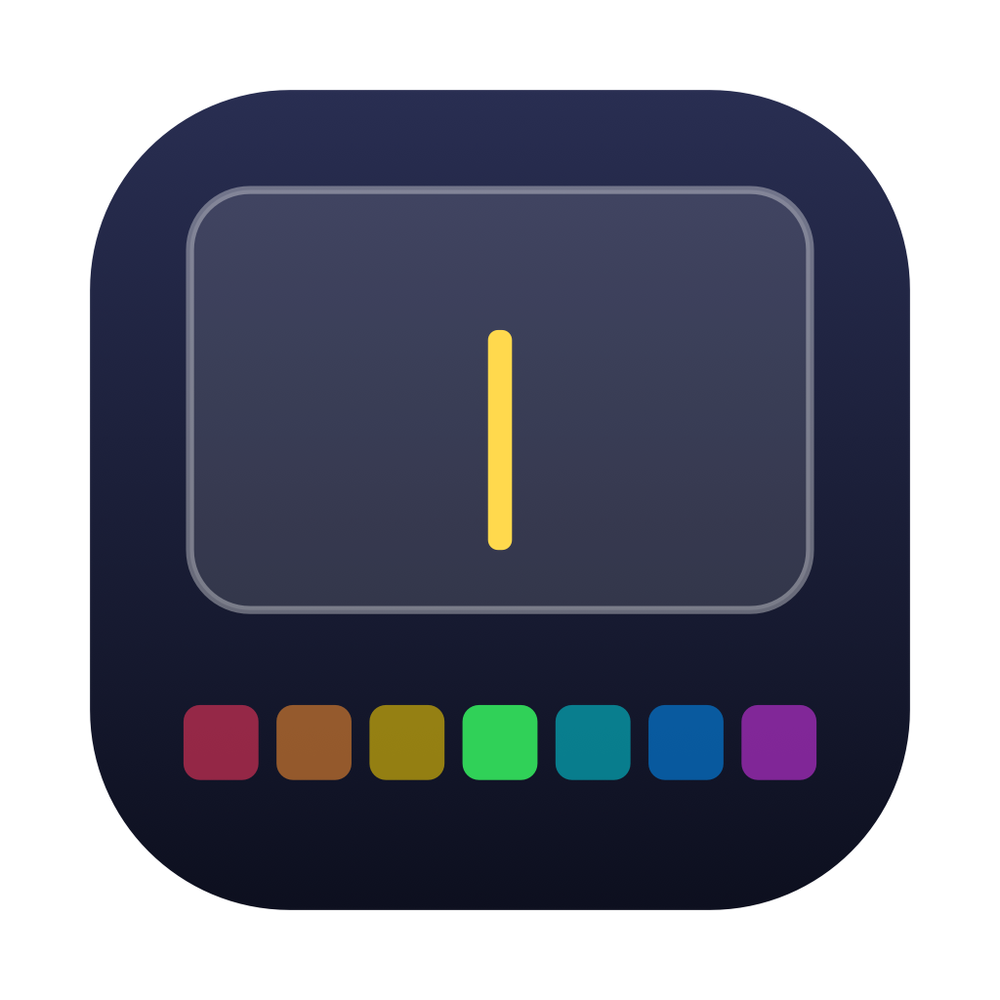
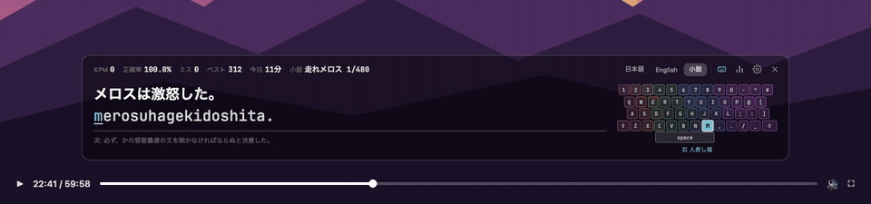
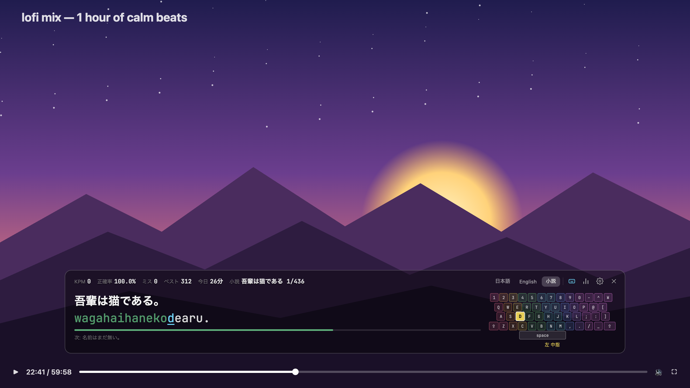
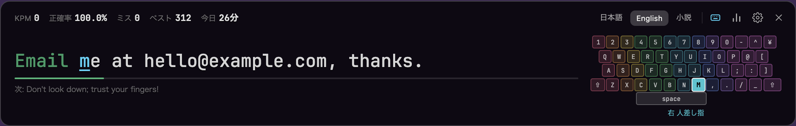

<div align="center">



# toumeiKey

**Learn touch typing while you watch videos.**

A translucent, always-on-top typing trainer that sits on top of YouTube.<br>
Windows & macOS · free · no account.

[](https://github.com/fkmstk/toumeiKey/releases/latest)
[](https://github.com/fkmstk/toumeiKey/releases)

[](LICENSE)
[](https://github.com/fkmstk/toumeiKey/stargazers)

[**⬇ Download**](#download) · [Usage](#usage) · [Features](#features) · [日本語](README.md)



</div>

## Why

Typing drills get boring fast. toumeiKey turns the time you already spend watching videos into practice: a translucent bar at the bottom of the screen shows a sentence, you type it, the video keeps playing. When you stop typing, the bar fades out of the way.

<p align="center"></p>

## Features

|  |  |
|---|---|
| 🪟 **Overlays any video** | Always on top and translucent; works over fullscreen browser video |
| ⌨️ **Ctrl+Alt+T to switch** | Jump between typing and your browser from any app — the video never stops |
| 🇬🇧 **English mode** | 101 sentences and 285 words, with capitals and punctuation |
| 🇯🇵 **Japanese romaji** | Accepts every common spelling (shi/si, chi/ti, っ, ん …) and works with the IME on |
| 📖 **Classic novels** | Six public-domain Japanese novels, one sentence at a time, resuming where you left off |
| 🎹 **Keyboard guide** | Shows the next key and which finger to use; auto-detects JIS / US layouts |
| 🔊 **Satisfying key sounds** | Five synthesized sound sets, panned left/right by hand |
| 📊 **Real analytics** | KPM trend, per-key heatmap, weakest keys, common mistypes, CSV export |
| 🔒 **Offline** | Everything stays on your machine. No account, no network |

KPM only counts the time you are actually typing, so pausing to watch doesn't hurt your score.




You can also practice your own text: paste from the clipboard or open a text file (one line per prompt).

## Download

**[Get the latest release](https://github.com/fkmstk/toumeiKey/releases/latest)**

| OS | File |
| --- | --- |
| Windows 10 / 11 | `TypingOverlay_x.x.x_x64-setup.exe` (or `.msi`) |
| macOS 11+ (Apple Silicon) | `TypingOverlay_x.x.x_aarch64.dmg` |

> [!NOTE]
> The builds are not code-signed, so you'll see a warning on first launch.
> - **Windows**: "Windows protected your PC" → "More info" → "Run anyway"
> - **macOS**: right-click the app → "Open" (or `xattr -dr com.apple.quarantine /Applications/TypingOverlay.app`)

The interface is in Japanese; the English mode and shortcuts work the same for everyone.

## Usage

1. Launch it — a bar appears at the bottom of the screen
2. Click the bar or press **Ctrl+Alt+T** and start typing
3. Press **Ctrl+Alt+T** again to hand focus back to your browser

Drag the background to move it, drag the edges to resize, right-click for the menu.

| Key | Action |
| --- | --- |
| Ctrl+Alt+T | Toggle focus between typing and your browser (global) |
| Esc / Tab | Restart line / skip |
| Ctrl(⌘)+1 / 2 / 3 / 4 | Japanese / English / Novel / Custom |
| Ctrl(⌘)+, | Settings |
| Ctrl(⌘)+S | Analytics |
| Ctrl(⌘)+K | Compact view |
| Ctrl(⌘)+G | Show / hide keyboard guide |
| Ctrl(⌘)+V / O | Practice clipboard text / a text file |
| Ctrl(⌘)+W / Q | Hide / quit |

## Build from source

Requires [Rust](https://rustup.rs/) and [Node.js](https://nodejs.org/) 20+. On Windows you also need WebView2 (built into Windows 10/11) and the Visual Studio C++ Build Tools.

```bash
git clone https://github.com/fkmstk/toumeiKey.git
cd toumeiKey
npm install
npm run dev      # run in development
npm run build    # build installers into src-tauri/target/release/bundle/
npm test         # romaji engine tests
```

Pushing a tag like `v1.2.3` makes GitHub Actions build and publish Windows and macOS releases.

## Contributing

Bug reports, ideas and pull requests are welcome — open an [issue](https://github.com/fkmstk/toumeiKey/issues). If you like it, a ⭐ helps a lot.

## Credits

Novel texts come from [Aozora Bunko](https://www.aozora.gr.jp/) (public-domain works). Readings combine Aozora's ruby with automatic morphological analysis ([fugashi](https://github.com/polm/fugashi) + UniDic) and may occasionally be wrong. Built with [Tauri](https://tauri.app/).

## License

[MIT](LICENSE). The novel texts are public-domain works distributed under [Aozora Bunko's terms](https://www.aozora.gr.jp/guide/kijyunn.html).
