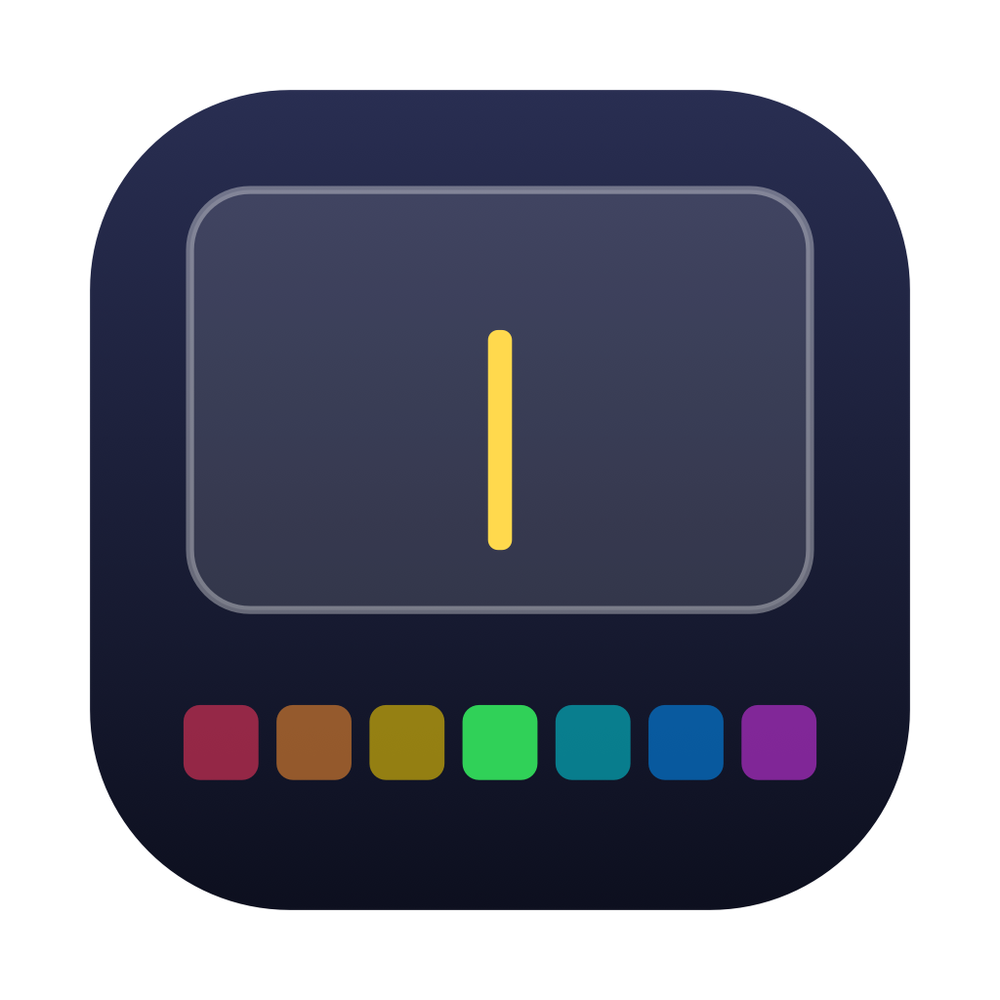
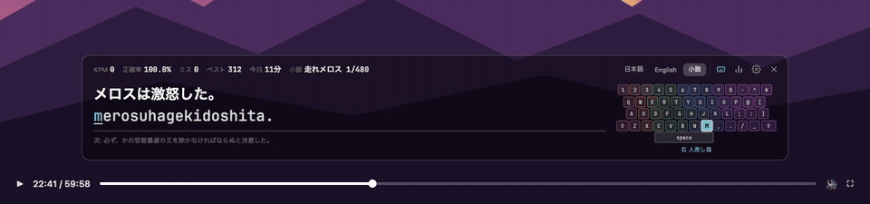
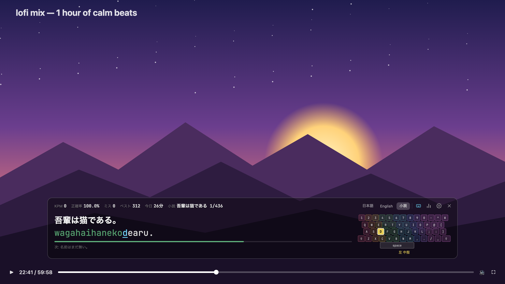
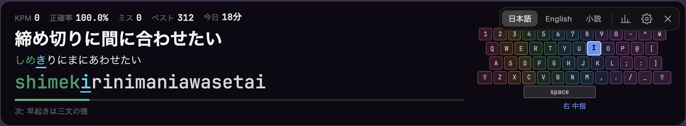
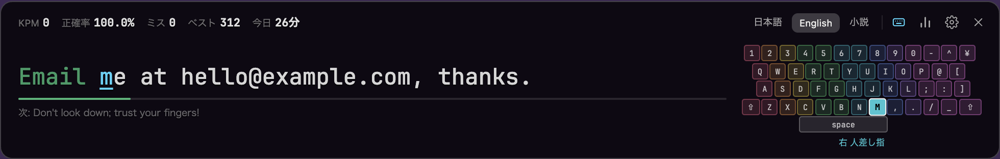
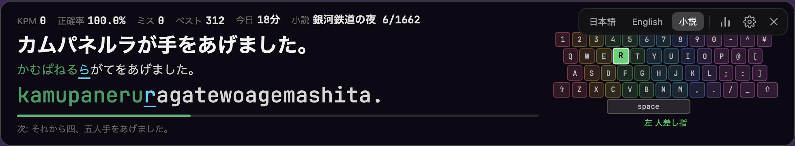
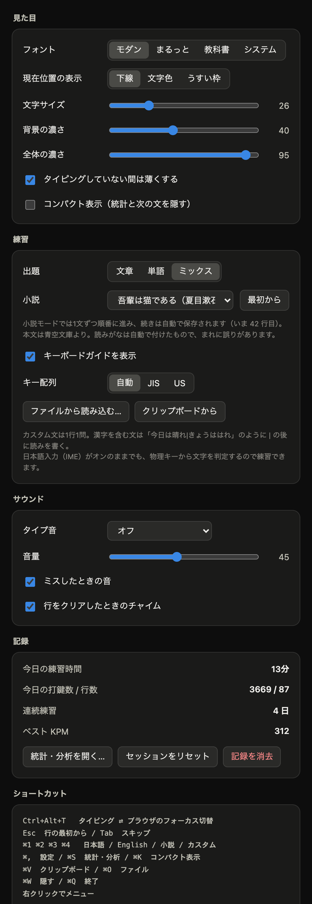

<div align="center">



# toumeiKey

**動画を見ながら、タッチタイピング。**

YouTube の上に重ねて打てる、半透明のタイピング練習アプリ。<br>
Windows / macOS 対応・無料・アカウント登録なし。

[](https://github.com/fkmstk/toumeiKey/releases/latest)
[](https://github.com/fkmstk/toumeiKey/releases)

[](LICENSE)
[](https://github.com/fkmstk/toumeiKey/stargazers)

[**⬇ ダウンロード**](#ダウンロード) ・ [使い方](#使い方) ・ [機能](#機能) ・ [English](README.en.md)



</div>

## こんな人に

- タイピング練習を始めても、**単調ですぐ飽きてしまう**
- 動画やライブ配信を見ている時間を、**ついでに練習の時間にしたい**
- ゲームっぽいタイピングサイトより、**静かに淡々と打ちたい**
- 日本語のローマ字入力も、英文も、**名作小説でも**練習したい

toumeiKey は画面の下に半透明の帯を出すだけ。動画はそのまま再生しながら、帯に表示された文を打っていきます。打っていない間は帯が薄くなって動画の邪魔をしません。

<p align="center"></p>

## 特徴

|  |  |
|---|---|
| 🪟 **動画の上に重なる** | 常に最前面・半透明。全画面の動画の上にも出せる |
| ⌨️ **Ctrl+Alt+T で一瞬で切り替え** | どのアプリからでも、タイピング ⇄ ブラウザ。動画は止まらない |
| 📖 **名作小説を1文ずつ** | 吾輩は猫である・走れメロス・銀河鉄道の夜など6作品。続きから再開 |
| 🇯🇵 **ローマ字入力に本気** | shi/si、chi/ti、っ・ん の打ち方の揺れに全部対応。IME オンのままでも OK |
| 🎹 **キーボードガイド** | 次に押すキーと指を色で表示。JIS / US 配列を自動判別 |
| 🔊 **気持ちいい打鍵音** | コトコト・カチカチ・タイプライターなど5種類。左手は左から、右手は右から聞こえる |
| 📊 **本格的な統計** | KPM の推移、キーごとのヒートマップ、苦手なキー・打ち間違い・苦手なかな |
| 🔒 **完全オフライン** | 記録はすべて手元に保存。アカウントも通信もなし |

## 機能

### 4つのモード



**日本語** — 日常の文章150・単語183。漢字かな交じりの文・読みがな・ローマ字を同時に表示。



**English** — 英文101・英単語285。大文字・記号もそのまま打つ。



**小説** — 青空文庫の名作を冒頭から1文ずつ。読み進めた位置は作品ごとに保存されるので、毎日少しずつ「読みながら打つ」ことができます。

| 作品 | 作者 | 行数 |
|---|---|---|
| 吾輩は猫である（一章） | 夏目漱石 | 436 |
| 坊っちゃん（一〜二章） | 夏目漱石 | 559 |
| 走れメロス | 太宰治 | 480 |
| 蜘蛛の糸 | 芥川龍之介 | 109 |
| 羅生門 | 芥川龍之介 | 212 |
| 銀河鉄道の夜 | 宮沢賢治 | 1,662 |

**カスタム** — 好きな文章をクリップボードやテキストファイルから読み込んで練習（[書き方](#カスタム文)）。

文章・単語ドリル・ミックスの切り替えもできます。

### 統計・分析


- 期間（7日 / 30日 / 全期間）ごとの平均 KPM・正確率・練習時間と、前の期間との比較
- KPM の推移（直近10行の移動平均）、日別の練習時間・KPM・正確率
- キーボードのヒートマップ（ミス率 / 打鍵間隔）、指ごとのミス率
- 苦手なキー・時間がかかるキー・よくある打ち間違い（Q→A など）・苦手なかな
- 連続練習日数、CSV 書き出し
- KPM は**打鍵している時間だけ**で計算するので、動画に見入って手が止まっても下がりません

### 見た目と音



- フォント4種（モダン / まるっと / 教科書 / システム）
- 背景の濃さ・全体の濃さ・文字サイズ
- 現在位置の表示（下線 / 文字色 / うすい枠）
- コンパクト表示（統計と次の文を隠す）
- タイプ音5種と音量、ミス音・行クリアのチャイム
- 打鍵音は音源ファイルを使わずその場で合成。毎回少しずつ音程が変わるので耳が疲れません

<br clear="right">

## ダウンロード

**[最新版のダウンロードはこちら](https://github.com/fkmstk/toumeiKey/releases/latest)**

| OS | ファイル |
| --- | --- |
| Windows 10 / 11 | `TypingOverlay_x.x.x_x64-setup.exe`（または `.msi`） |
| macOS 11 以降（Apple Silicon） | `TypingOverlay_x.x.x_aarch64.dmg` |

> [!NOTE]
> コード署名をしていないため、初回起動時に警告が出ます。
> - **Windows**: 「Windows によって PC が保護されました」→「詳細情報」→「実行」
> - **macOS**: アプリを右クリック →「開く」（または `xattr -dr com.apple.quarantine /Applications/TypingOverlay.app`）

## 使い方

1. 起動すると画面の下に帯が出ます
2. 帯をクリックするか **Ctrl+Alt+T** で打ち始める
3. 動画を操作したいときはもう一度 **Ctrl+Alt+T**。ブラウザにフォーカスが戻ります

- 背景をドラッグして移動、左右の端でサイズ変更（高さは内容に合わせて自動）
- **右クリック**でメニュー（モード・出題・小説の作品・タイプ音・コンパクト表示など）
- 右上のボタンでモード切替・キーボードガイドの開閉・統計・設定・終了
- 日本語入力（IME）がオンのままでも、押した物理キーから文字を判定するので練習できます

| キー | 動作 |
| --- | --- |
| Ctrl+Alt+T | タイピング ⇄ ブラウザのフォーカス切替（どのアプリからでも） |
| Esc / Tab | 行の最初から / スキップ |
| Ctrl(⌘)+1 / 2 / 3 / 4 | 日本語 / English / 小説 / カスタム |
| Ctrl(⌘)+, | 設定 |
| Ctrl(⌘)+S | 統計・分析 |
| Ctrl(⌘)+K | コンパクト表示 |
| Ctrl(⌘)+G | キーボードガイドの表示 / 非表示 |
| Ctrl(⌘)+V / O | クリップボード / テキストファイルの文章で練習 |
| Ctrl(⌘)+W / Q | 隠す / 終了 |

### カスタム文

1行に1問。漢字を含む文は `|` の後に読みを書きます。

```text
今日は晴れ|きょうははれ
the quick brown fox
ひらがなだけの文はそのままでOK
```

## よくある質問

<details>
<summary><b>YouTube 以外でも使える？</b></summary>

使えます。帯はただの最前面ウィンドウなので、Netflix・Twitch・ニコニコ動画・Zoom・ゲーム画面など、どのアプリの上にも重ねられます。
</details>

<details>
<summary><b>全画面の動画の上にも出せる？</b></summary>

macOS ではブラウザの全画面表示の上にも出ます。Windows でもブラウザの全画面（F11 / 動画の全画面ボタン）なら多くの場合重ねられます。ゲームの「排他的フルスクリーン」の上には出せません。
</details>

<details>
<summary><b>日本語入力をオフにしないといけない？</b></summary>

不要です。IME がオンでも、押したキーの位置から文字を判定します。
</details>

<details>
<summary><b>記録はどこに保存される？ 送信される？</b></summary>

すべてパソコンの中（アプリ内のストレージ）に保存され、どこにも送信されません。統計画面から CSV で書き出せます。
</details>

<details>
<summary><b>Linux 版は？</b></summary>

今は Windows と macOS のみです。Tauri 製なのでビルド自体はできるはずなので、試した方は Issue で教えてください。
</details>

## ソースからビルド

必要なもの: [Rust](https://rustup.rs/)、[Node.js](https://nodejs.org/) 20 以上。Windows は WebView2（Windows 10/11 は標準搭載）と Visual Studio Build Tools（C++）。

```bash
git clone https://github.com/fkmstk/toumeiKey.git
cd toumeiKey
npm install
npm run dev      # 開発用に起動
npm run build    # インストーラーを作成（src-tauri/target/release/bundle/）
npm test         # ローマ字判定のテスト（全問題 + 小説 3,458 行）
```

`v1.2.3` のようなタグを push すると、GitHub Actions が Windows / macOS 版をビルドして Releases に公開します。

<details>
<summary>ディレクトリ構成</summary>

```text
src/                 画面（HTML / CSS / JavaScript、ビルド不要）
  index.html         帯
  settings.html      設定ウィンドウ
  analytics.html     統計・分析ウィンドウ
  js/romaji.js       ローマ字入力エンジン
  js/model.js        タイピングの判定と出題
  js/analytics.js    記録の保存と集計
  js/sound.js        タイプ音の合成
  js/keyboard.js     キー配列（JIS / US）と指の割り当て
  js/vocab.js        問題データ
  js/novels.js       小説データ（tools/make_novels.py で生成）
src-tauri/           ウィンドウ制御・トレイ・ホットキー（Rust）
tools/               データ生成スクリプト
tests/               テスト
docs/images/         README の画像
macos-swift/         最初に作った macOS ネイティブ（Swift / AppKit）版
```
</details>

## コントリビュート

バグ報告・要望・プルリクエスト大歓迎です。

- 🐛 不具合や「この読みがなが違う」は [Issue](https://github.com/fkmstk/toumeiKey/issues) へ
- 📖 収録してほしい作品（著作権の切れたもの）のリクエストも Issue でどうぞ。作品の追加は `tools/make_novels.py` に1行足すだけです
- ⭐ 気に入ったらスターをもらえると、とても励みになります

## クレジット

小説の本文は[青空文庫](https://www.aozora.gr.jp/)の入力・校正によるものです（いずれも著作権の切れた作品）。読みがなは青空文庫のルビと、形態素解析（[fugashi](https://github.com/polm/fugashi) + UniDic）で自動的に付けたもので、まれに誤りがあります。

| 作品 | 底本 |
|---|---|
| 吾輩は猫である | 「夏目漱石全集1」ちくま文庫、筑摩書房 |
| 坊っちゃん | 「ちくま日本文学全集　夏目漱石」筑摩書房 |
| 走れメロス | 「太宰治全集3」ちくま文庫、筑摩書房 |
| 蜘蛛の糸 | 「芥川龍之介全集2」ちくま文庫、筑摩書房 |
| 羅生門 | 「芥川龍之介全集1」ちくま文庫、筑摩書房 |
| 銀河鉄道の夜 | 「銀河鉄道の夜」角川文庫、角川書店 |

[Tauri](https://tauri.app/) で作られています。

## ライセンス

[MIT License](LICENSE) — 自由に使用・改変・再配布できます。小説の本文は著作権の切れた作品で、青空文庫の[収録ファイルの取り扱い規準](https://www.aozora.gr.jp/guide/kijyunn.html)に従っています。
